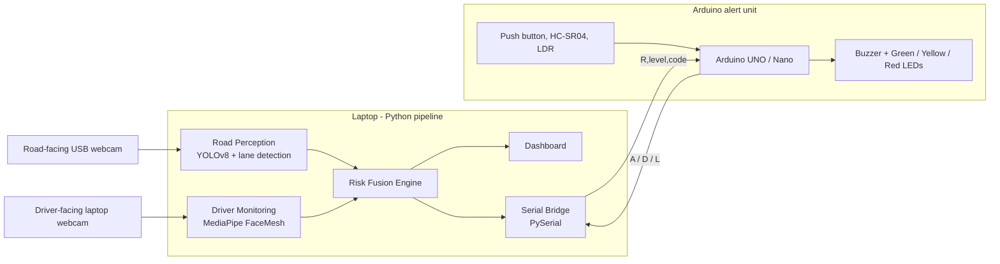
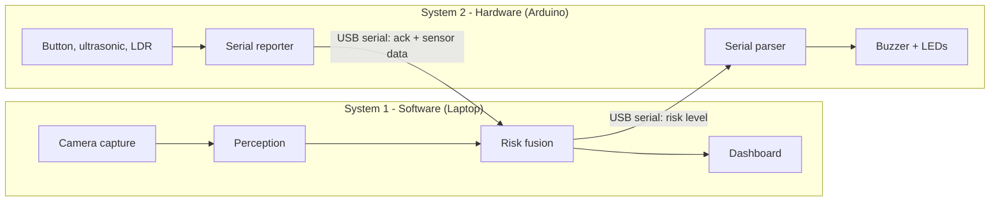
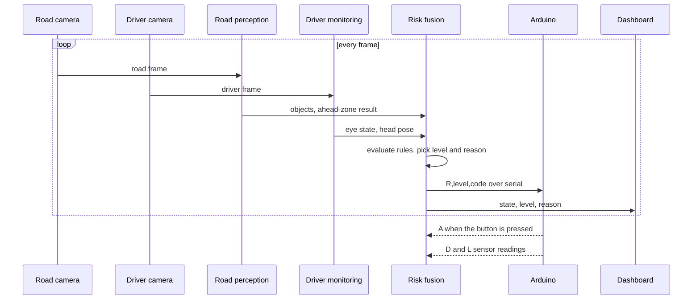
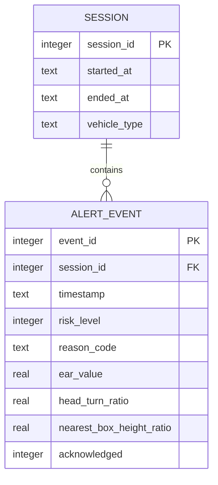
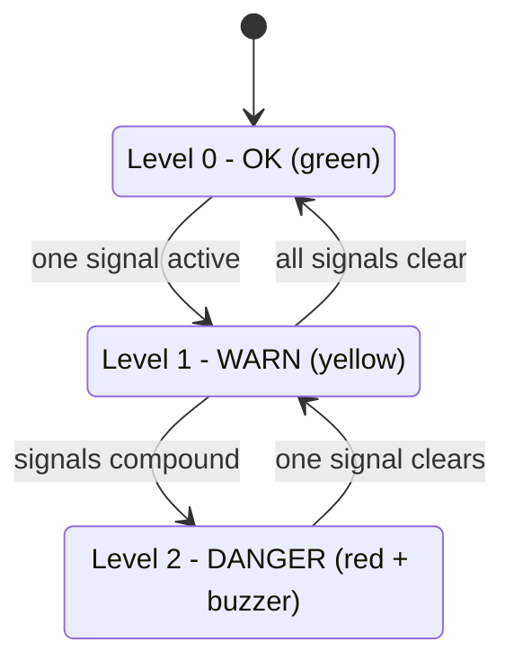
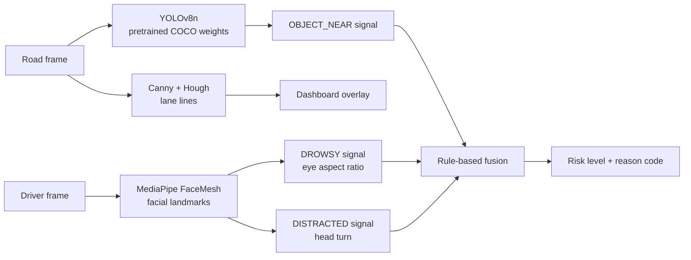

# DriveGuard AI

**A camera-only driver safety system that watches the road and the driver at the same time, and raises a graded alert before a lapse in attention becomes a collision.**

> **Prototype notice:** DriveGuard AI is a research prototype (Technology Readiness Level 3). It is a driver-assistance concept, not a certified safety device, and must not be relied on to prevent accidents.

**Status legend:** ✅ Built and verified &nbsp;|&nbsp; 🚧 In progress &nbsp;|&nbsp; ⏳ Planned

---

# 📚 Technical Documentation

## 📋 Table of Contents

1. [Executive Summary](#1-executive-summary)
2. [Problem Statement](#2-problem-statement)
3. [Key Features](#3-key-features)
4. [System Architecture](#4-system-architecture)
5. [Dual System Map](#5-dual-system-map)
6. [Core Modules](#6-core-modules)
7. [Runtime Data Flow](#7-runtime-data-flow)
8. [Data Storage & Event Schema](#8-data-storage--event-schema)
9. [Risk Model & Signal Representation](#9-risk-model--signal-representation)
10. [AI & Hybrid Perception Engine](#10-ai--hybrid-perception-engine)
11. [Alert Provenance & Deterministic Rules](#11-alert-provenance--deterministic-rules)
12. [Interface Specification](#12-interface-specification)
13. [Technology Stack](#13-technology-stack)
14. [Installation & Setup](#14-installation--setup)
15. [Configuration & Environment Variables](#15-configuration--environment-variables)
16. [Running the System](#16-running-the-system)
17. [Verification & Testing](#17-verification--testing)
18. [Docker & Containerized Deployment](#18-docker--containerized-deployment)
19. [Security Safeguards](#19-security-safeguards)
20. [Known Limitations](#20-known-limitations)
21. [Future Roadmap](#21-future-roadmap)
- [📄 License](#-license)

---

## 1. Executive Summary

DriveGuard AI combines three layers into one pipeline:

1. **Road perception** detects vehicles, pedestrians and lane position from a road-facing camera.
2. **Driver monitoring** estimates drowsiness and distraction from a driver-facing camera.
3. **Risk fusion** merges both into a single graded risk level and sends it to a physical alert unit (buzzer and LED indicator) and a live dashboard.

It runs on consumer-grade hardware with no LiDAR or radar, so it can be fitted to vehicles that have no driver-assistance system today.

| Item | Detail |
|---|---|
| Stage | Prototype (TRL 3) |
| Target vehicle (current build) | Cars |
| Team | Solo project, Yash Khanavkar |
| Hardware cost | About ₹1,100 (breadboard prototype) |
| Primary language | Python 3.12 (alert firmware in Arduino C++) |
| Community | Built for the Adhisthan tech community |

## 2. Problem Statement

Fatigue, distraction and delayed hazard perception are leading human causes of road crashes. Driver-assistance systems that watch both the road and the driver exist, but they are mostly found in premium vehicles that rely on costly sensor suites. Budget cars, two-wheelers and commercial fleet vehicles, which carry some of the longest driving hours, usually have no equivalent protection.

Existing research also tends to treat the two halves separately: drowsiness detection from facial cues on one side, road-hazard detection from forward cameras on the other. Few systems reason about both at once, even though the risk is highest when they coincide, for example a close vehicle ahead while the driver's eyes are closed.

**DriveGuard AI targets two gaps:**
- an affordable safety layer that can be retrofitted to vehicles that lack one;
- a fusion step that combines road conditions and driver state into one explainable risk level.

## 3. Key Features

| Feature | Description | Status |
|---|---|---|
| Driver monitoring | Drowsiness (eye aspect ratio, eye-closure duration) and distraction (head pose, face loss) from facial landmarks | 🚧 In progress |
| Road perception | Vehicle and pedestrian detection with pretrained YOLOv8 | ⏳ Planned |
| Lane detection | Classical computer vision (Canny edges and Hough transform) | ⏳ Planned |
| Risk fusion | Rule-based combination of signals into a three-level risk score with a reason code | ⏳ Planned |
| Physical alert unit | Arduino-driven buzzer, green/yellow/red LEDs and a push-button acknowledge | ✅ Built (breadboard) |
| Redundant sensors | Ultrasonic close-range proximity and LDR ambient-light sensing | ✅ Built (breadboard) |
| Live dashboard | Streamlit view of both feeds, driver state, risk level and alert reason | ⏳ Planned |

**Design goals:** low cost, runs on a laptop CPU, explainable alerts, fully local processing.

## 4. System Architecture



All perception and fusion run on the laptop. The Arduino is a deliberately simple output and sensor unit that only parses short serial messages.

## 5. Dual System Map

DriveGuard AI is two cooperating systems that meet only at a USB serial cable.



### System 2 hardware

| Component | Purpose |
|---|---|
| Arduino UNO (bench testing) / Arduino Nano (final build) | Reads risk messages, drives outputs, reports sensors |
| Active buzzer module | Audible alert |
| Green, yellow and red LEDs with 220 Ω resistors | At-a-glance risk indicator |
| Push button | Driver acknowledges and temporarily mutes an alert |
| HC-SR04 ultrasonic module | Redundant close-range proximity reading |
| LDR module | Ambient light level |

### Pin map

| Component | Arduino pin |
|---|---|
| Buzzer (signal) | D8 |
| Green LED | D5 |
| Yellow LED | D6 |
| Red LED | D7 |
| Push button | D2 (INPUT_PULLUP, other leg to GND) |
| Ultrasonic Trig | D9 |
| Ultrasonic Echo | D10 |
| LDR analog out | A0 |

All VCC lines go to 5 V and all GND lines to ground. Each LED needs its own 220 Ω series resistor. The cameras connect to the laptop over USB and do not touch the Arduino circuit.

> The physical OLED/LCD display was dropped after repeated bring-up failures. Its job (showing risk level and reason) moves to the software dashboard.

## 6. Core Modules

| Module | Path | Responsibility | Status |
|---|---|---|---|
| Driver monitoring | `driver_monitoring/` | Face landmarks, eye aspect ratio, head pose, drowsiness and distraction signals | 🚧 |
| Road perception | `road_perception/` | YOLOv8 detection, ahead-zone check, lane lines | ⏳ |
| Risk fusion | `risk_fusion/` | Combines signals into level and reason code | ⏳ |
| Dashboard | `dashboard/` | Streamlit UI with both feeds and alert state | ⏳ |
| Alert firmware | `firmware/` | Arduino sketch for outputs, button and sensors | 🚧 (hardware self-test done) |
| Hardware docs | `hardware/` | Wiring reference and parts list | ⏳ |

```
driveguard-ai/
├── driver_monitoring/   # MediaPipe drowsiness and distraction tracking
├── road_perception/     # YOLOv8 object detection and lane detection
├── risk_fusion/         # Risk scoring and alert-threshold logic
├── dashboard/           # Streamlit UI
├── firmware/            # Arduino sketch (buzzer, LEDs, button, sensors)
├── hardware/            # Wiring reference and parts list
├── data/                # Dataset subsets and test clips (gitignored)
├── requirements.txt
└── README.md
```

**Planned module interfaces** (design, not yet implemented):

```python
analyze_driver(frame) -> DriverState    # ear, eyes_closed_s, head_turn_ratio, face_found
analyze_road(frame)   -> RoadState      # objects, nearest_box_height_ratio, lane_offset
assess(driver, road)  -> RiskAssessment # level (0-2), code, active_signals
```

## 7. Runtime Data Flow



Each frame follows the same path: capture, analyse, fuse, then fan out to the Arduino and the dashboard. The risk level is re-sent about once per second as a heartbeat, so the Arduino can detect a lost link.

## 8. Data Storage & Event Schema

The real-time pipeline needs **no database**. All state lives in memory, and video frames are never written to disk by default.

An optional local **SQLite** event log is planned for reviewing sessions after the fact. It stores numeric signals and reason codes only, never images.



```sql
CREATE TABLE session (
    session_id   INTEGER PRIMARY KEY,
    started_at   TEXT NOT NULL,
    ended_at     TEXT,
    vehicle_type TEXT DEFAULT 'car'
);

CREATE TABLE alert_event (
    event_id                 INTEGER PRIMARY KEY,
    session_id               INTEGER NOT NULL REFERENCES session(session_id),
    timestamp                TEXT NOT NULL,
    risk_level               INTEGER NOT NULL CHECK (risk_level IN (0, 1, 2)),
    reason_code              TEXT NOT NULL,
    ear_value                REAL,
    head_turn_ratio          REAL,
    nearest_box_height_ratio REAL,
    acknowledged             INTEGER NOT NULL DEFAULT 0
);
```

Status: ⏳ Planned. Datasets and test clips live in `data/`, which is gitignored.

## 9. Risk Model & Signal Representation

The perception layers reduce raw video to a small set of named signals. Fusion works only on these signals, never on pixels.

| Signal | Source | Active when (initial values, to be tuned) |
|---|---|---|
| `DROWSY` | Driver monitoring | Eye aspect ratio below threshold for at least 1.5 s |
| `DISTRACTED` | Driver monitoring | Head turned beyond the limit, or face not found, for at least 2.0 s |
| `OBJECT_NEAR` | Road perception | A vehicle or person box inside the ahead zone with height of at least 35% of the frame |

**Risk levels**

| Level | Name | Condition | Alert |
|---|---|---|---|
| 0 | OK | No active signal | Green LED |
| 1 | WARN | Exactly one signal active | Yellow LED |
| 2 | DANGER | Two or more signals (`COMPOUND`), or `DROWSY` for 2.5 s or more | Red LED and pulsing buzzer |



Pressing the push button mutes the buzzer for a fixed window. It silences the sound only and does not change the risk level.

## 10. AI & Hybrid Perception Engine

DriveGuard AI is a hybrid of a deep-learning detector, deterministic landmark geometry and classical computer vision, followed by transparent rules.



**Drowsiness.** Eye aspect ratio (EAR) from six landmarks per eye:

```
EAR = ( |p2 - p6| + |p3 - p5| ) / ( 2 * |p1 - p4| )
```

EAR falls toward zero as the eye closes. A short per-user calibration with eyes open sets the threshold.

**Distraction.** Head turn is estimated from facial landmark geometry (nose position relative to the cheek landmarks) and held for a minimum duration before it counts.

**Road perception.** A pretrained YOLOv8n model detects persons, bicycles, cars, motorcycles, buses and trucks. A box inside the central "ahead zone" with enough height triggers `OBJECT_NEAR`. Box size is an approximate proxy for distance, not a measurement.

**Why pretrained, rule-based?** No training data collection is needed, behaviour is predictable, and every alert can be traced to a rule. Fine-tuning and learned fusion are future work.

## 11. Alert Provenance & Deterministic Rules

Every alert should be explainable. Fusion is a pure function: the same inputs always produce the same level and reason.

- Each alert carries a **reason code** (`DROWSY`, `DISTRACTED`, `OBJECT_NEAR`, `COMPOUND`) and the list of active signals.
- Thresholds and timers live in configuration (section 15), not scattered in code.
- Fusion is unit-testable without cameras, using fixed signal inputs.
- Alerts can be logged with the numeric values that caused them (section 8).

This is what separates a traceable safety aid from an opaque "AI said so" alarm.

## 12. Interface Specification

DriveGuard AI has no network API. Its external interface is a line-based **serial protocol** between laptop and Arduino. *This section is the planned specification; the full firmware that implements it is part of the next milestones.*

**Link:** USB serial, 9600 baud, 8N1, newline-terminated ASCII lines.

**Laptop to Arduino**

| Message | Meaning |
|---|---|
| `R,<level>,<CODE>` | Set risk level. `level` is `0`, `1` or `2`. `CODE` is `OK`, `DROWSY`, `DISTRACTED`, `OBJECT_NEAR` or `COMPOUND`. Example: `R,2,COMPOUND` |

**Arduino to laptop**

| Message | Meaning |
|---|---|
| `A` | Push button pressed (acknowledge) |
| `D,<cm>` | Ultrasonic distance reading |
| `L,<0-1023>` | LDR light reading |

**Behaviour rules**
- The laptop sends `R,...` on every change and as a 1-second heartbeat.
- If no valid message arrives for 3 seconds, the Arduino shows a "link lost" indication (blinking yellow LED, buzzer off).
- Malformed lines are ignored. Unknown codes never change the output.

## 13. Technology Stack

| Layer | Technology |
|---|---|
| Language | Python 3.12, Arduino C++ |
| Object detection | Ultralytics YOLOv8 (pretrained `yolov8n`) |
| Face landmarks | MediaPipe FaceMesh (pinned to 0.10.14) |
| Vision and video | OpenCV |
| Numerics | NumPy |
| Deep-learning backend | PyTorch (installed with Ultralytics) |
| Serial link | PySerial |
| Dashboard | Streamlit |
| Optional storage | SQLite |
| Microcontroller | Arduino UNO / Nano (ATmega328P) |
| Version control | Git and GitHub (`main`, `test`, `feature/*` branches) |

**Datasets (evaluation and replay testing):** KITTI and BDD100K for road scenes, NTHU-DDD for driver drowsiness.

## 14. Installation & Setup

**Prerequisites**
- Windows with Python **3.12**
- Git
- Arduino IDE (to upload firmware)
- A USB webcam (road) and a laptop webcam (driver)

```powershell
git clone https://github.com/Alphaa1556/driveguard-ai.git
cd driveguard-ai
git checkout test

py -3.12 -m venv venv
venv\Scripts\Activate.ps1
pip install -r requirements.txt
```

If PowerShell blocks activation, run `Set-ExecutionPolicy -Scope Process Bypass` first.

**Verify the install**
```powershell
python -c "import cv2, mediapipe, ultralytics, serial; print('OK')"
```

> MediaPipe is pinned to `0.10.14` because newer releases removed the `mp.solutions` API this project uses. Keep the repository outside synced folders such as OneDrive to avoid file-lock errors during Git operations.

## 15. Configuration & Environment Variables

*Planned. These values will be read from a `.env` file at the repository root (gitignored). Defaults are starting points to be tuned during testing.*

| Variable | Default | Meaning |
|---|---|---|
| `DRIVER_CAMERA_INDEX` | `0` | Camera used for the driver |
| `ROAD_CAMERA_INDEX` | `1` | Camera used for the road (or a video path) |
| `SERIAL_PORT` | `COM3` | Arduino serial port |
| `SERIAL_BAUD` | `9600` | Serial speed |
| `YOLO_MODEL` | `yolov8n.pt` | Detection weights |
| `EAR_THRESHOLD` | `0.21` | Eye-closed threshold before calibration |
| `EYES_CLOSED_SECONDS` | `1.5` | Duration for `DROWSY` |
| `HEAD_TURN_SECONDS` | `2.0` | Duration for `DISTRACTED` |
| `OBJECT_NEAR_HEIGHT_RATIO` | `0.35` | Box height ratio for `OBJECT_NEAR` |
| `ACK_MUTE_SECONDS` | `10` | Buzzer mute after the button is pressed |

No API keys or secrets are required.

## 16. Running the System

**Available now: hardware self-test.** Upload the self-test sketch in `firmware/` with the Arduino IDE, open Serial Monitor at 9600 baud, and confirm the LEDs, buzzer, button, ultrasonic distance and LDR readings respond.

**Planned: full pipeline**
```powershell
# 1. Upload the alert firmware to the Arduino, then close Serial Monitor
# 2. Start the dashboard
streamlit run dashboard/app.py
```

Run without hardware by leaving the serial port unset. The pipeline then runs in camera-only mode.

## 17. Verification & Testing

| Area | Method | Status |
|---|---|---|
| Alert hardware | Bench self-test sketch checks buzzer, three LEDs, button, ultrasonic and LDR through Serial Monitor | ✅ Done |
| EAR calculation | Unit tests with fixed landmark inputs (open and closed eye) | ⏳ Planned |
| Risk fusion rules | Unit tests covering every signal combination and level | ⏳ Planned |
| Serial protocol | Parser tests for valid, malformed and unknown messages | ⏳ Planned |
| Road perception | Replay of recorded dashcam clips, manual review of detections | ⏳ Planned |
| Driver monitoring | Live webcam trials in varied lighting, validation against NTHU-DDD clips | ⏳ Planned |
| End to end | Full demo run with Arduino, recorded on video | ⏳ Planned |

Performance (frames per second on a laptop CPU) will be measured and reported once the pipeline runs end to end.

## 18. Docker & Containerized Deployment

**Not containerized, by design.** The system needs direct access to USB webcams and a serial port. Passing those devices into containers on Windows is fragile and adds friction without benefit for a single-machine prototype.

Containerization becomes relevant if a cloud inference or fleet-analytics service is added (see section 21). That service would have no direct hardware access and could be packaged as a container.

## 19. Security Safeguards

- **Local processing.** No video or image leaves the machine, and no network access is required.
- **No frame storage.** Frames are processed in memory. The optional event log stores numbers and codes only.
- **Input validation.** The serial parser accepts a fixed vocabulary and ignores anything else.
- **Fail-safe link.** A lost link is signalled visibly instead of leaving a stale alert state.
- **Secrets.** None required. `.env` and `venv/` are gitignored.
- **Dataset licences.** KITTI and BDD100K have their own terms. Check them before any commercial use.
- **Driver privacy.** Driver-face data is sensitive. Any future fleet product would need explicit consent and a data-retention policy.

## 20. Known Limitations

- **Prototype only.** Not validated in a moving vehicle and not a certified safety device.
- **Car-only scope.** Two-wheelers, rickshaws and trucks are not supported yet.
- **Approximate distance.** Proximity comes from bounding-box size in a single camera, not a calibrated measurement.
- **Camera quality.** A low-cost 480p webcam limits detection at night, in glare and at long range.
- **Lighting sensitivity.** Face landmarks degrade in poor light, with sunglasses or with strong head angles.
- **CPU-only performance.** Running YOLOv8 and FaceMesh together on a laptop CPU limits frame rate.
- **Unintegrated sensors.** The ultrasonic and LDR sensors work on the bench but do not yet feed the fusion rules.
- **Breadboard build.** The alert unit is a breadboard prototype, not a permanent PCB.
- **No physical display.** The OLED/LCD was dropped, so detailed status is shown on the software dashboard only.
- **Rule thresholds untuned.** Initial threshold values need tuning on real data.

## 21. Future Roadmap

**Near term (core milestones)**
- [x] Project scope, architecture and documentation
- [x] Repository, branches and environment
- [x] Hardware alert unit (breadboard prototype)
- [ ] Driver monitoring: landmarks, EAR, drowsiness, distraction
- [ ] Road perception: YOLOv8 detection and ahead-zone logic
- [ ] Lane detection (Canny and Hough)
- [ ] Risk fusion and serial link to the Arduino
- [ ] Streamlit dashboard
- [ ] Demo video and test report

**Medium term**
- Permanent build on a Nano with a soldered PCB
- Revisit a physical display
- Integrate the ultrasonic and LDR sensors into fusion
- Calibrated distance estimation and night-time camera options
- Edge deployment on a Raspberry Pi or Jetson-class device

**Long term**
- Extend to two-wheelers, auto-rickshaws and commercial trucks
- Fine-tune detection on driving datasets and evaluate learned fusion
- Fleet-level analytics (a containerized cloud service) and a retrofit-kit business model
- Evaluation on real-vehicle drives

## 📄 License

Not yet specified. Until a `LICENSE` file is added, all rights are reserved by the author.

---

**Author:** Yash Khanavkar, BE Computer Science (AI & ML), MGM College of Engineering and Technology
[LinkedIn](https://linkedin.com/in/yashkhanavkar) · [GitHub](https://github.com/Alphaa1556)

*Built as a solo project for the Adhisthan tech community.*
